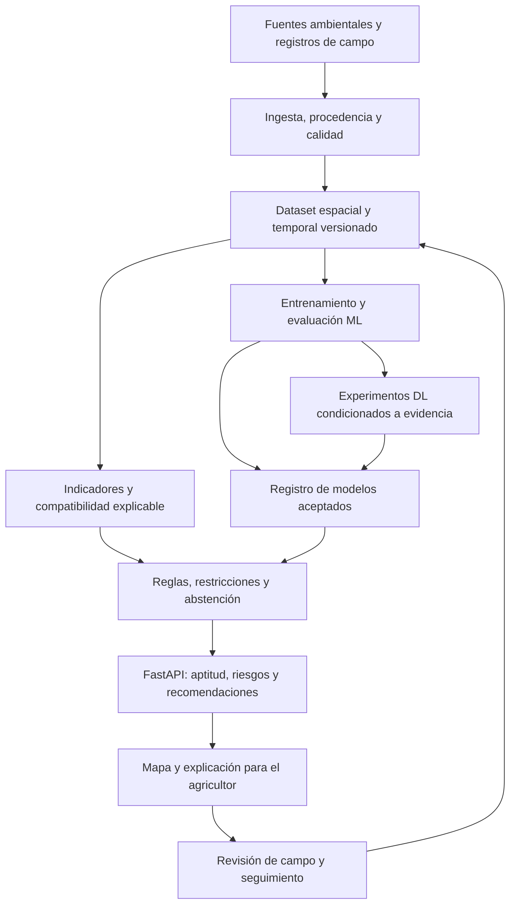

# Plan de ML/DL para aptitud agrícola, riesgos y recomendación de cultivos

**Fecha:** 14 de noviembre de 2026.

**Rama de trabajo:** `plan/ml-dl-agricultural-decisions`.

**Complejidad:** alta; depende de cobertura histórica y validación agronómica.

**Estado:** implementación iniciada por solicitud del usuario para una hackatón. Primer incremento: configuración/auditoría del piloto, pipeline Chronos-2 preentrenado, comparación retrospectiva, API y panel del mapa; [alcance](ml-pilot-scope.md) y [demo reproducible](pretrained-rain-demo.md). El resto de tareas de esta hoja de ruta sigue planificado; no se presume que estén terminadas ni validadas.

**Segundo incremento:** tres entrenamientos LoRA reales, histórico ampliado a treinta años, selección por validación y comparación final con métricas visibles. Los adaptadores no superaron el criterio de validación y se conserva el pronóstico original. [Método y resultados](rain-fine-tuning-experiment.md).

**Tercer incremento:** [mapa de aptitud histórica regional](agricultural-suitability.md) con doce extractos FAO/IIASA GAEZ v5 verificados para maíz, papa y cebada, cuatro escenarios de agua/manejo y tres grupos de aptitud, separando faltantes y agua. Incluye API, cuadrícula nativa interactiva, fuentes y controles de cobertura. Integra los cinco factores mediante el modelo agroecológico publicado; no mide humedad actual ni sustituye la validación local. Haba, recomendaciones aprendidas, alertas y expansión nacional siguen pendientes.

**Cuarto incremento:** [alertas agrícolas regionales](agricultural-risk-alerts.md) para nueve puntos de Cusco: déficit de lluvia frente a ventanas 1991–2020, frío/calor y lluvia intensa previstos, posible erosión por lluvia/relieve y señal de estrés hídrico por suelo modelado/déficit climático. API y mapa con evidencia, cobertura y caducidad; datos reales preparados y pruebas. Sin validación agronómica ni renovación periódica desplegada. Las alertas de este incremento son reglas exploratorias, no clasificaciones aprendidas o avisos oficiales.

## 1. Objetivo y resultado para el agricultor

Permitir que una persona seleccione una zona y una temporada para responder:

1. ¿Qué zonas tienen condiciones ambientales compatibles con un cultivo determinado?
2. ¿Qué zonas requieren monitoreo por sequía, temperaturas extremas, exceso de lluvia, posible erosión o estrés hídrico?
3. ¿Qué cultivos conviene considerar en esa zona y qué alternativas de rotación pueden revisarse?

La respuesta combinará un mapa, una lista de hasta tres cultivos candidatos cuando exista evidencia suficiente y explicaciones comprensibles: condiciones favorables, restricciones, fecha de los datos y qué verificar en campo. También podrá devolver menos candidatos o abstenerse. Las alertas indicarán qué se observó o estimó, dónde, durante qué periodo y qué revisar. «Evitar para este cultivo y temporada» requerirá una incompatibilidad crítica documentada y validada; los datos faltantes producirán «Información insuficiente».

Se implementarán dos recorridos: **cultivo → zonas**, para comparar celdas dentro de un área de búsqueda acotada; y **zona → cultivos**, para comparar especies en el lugar elegido. El primero devolverá geometrías, clases/indicadores y restricciones por celda, no solamente un resultado del centroide del área.

Se distinguirán tres productos con evaluaciones independientes:

| Producto | Pregunta | Alcance inicial |
|---|---|---|
| Aptitud histórica | ¿Qué zonas suelen ofrecer condiciones compatibles? | Comparación agroclimática por cultivo, temporada y régimen de agua. |
| Monitoreo | ¿Qué condiciones recientes merecen atención? | Señales basadas en observaciones disponibles, con su retraso real. |
| Predicción | ¿Qué evento podría ocurrir después de la fecha de consulta? | Experimento separado, con horizonte, información disponible y calidad comprobados. |

Una anomalía meteorológica no demuestra daño agrícola. Un puntaje de compatibilidad no será presentado como probabilidad de cosecha exitosa, rendimiento esperado ni rentabilidad.

## 2. Punto de partida verificado en el repositorio

La inspección fue local: no se verificaron credenciales, servicios de producción ni descargas satelitales reales durante esta planificación.

| Componente | Evidencia actual | Consecuencia para el plan |
|---|---|---|
| Aplicación | React/TypeScript/Vite, Leaflet y FastAPI; `frontend/src/GeoWorkspace.tsx`, `backend/app/main.py`. | Extender la aplicación existente. |
| Meteorología | `backend/app/connectors/nasa_power.py` consulta lluvia, temperatura media/máxima/mínima y humedad relativa diaria. | Base reutilizable para el dataset histórico. Faltan radiación y viento para implementar ETo con las entradas previstas. |
| IA actual | `backend/app/services/decision_ai.py` y `arie.py` usan búsqueda y restricciones. | Reutilizar reglas de secuencia, manteniendo diferenciadas la evidencia aprendida y la estructural. |
| ML actual | Ridge de lluvia mensual en `backend/app/ml/rain_model.py`, ejecutado por `backend/train_rain_ai.py`. | Conservar como referencia experimental; su evaluación temporal no habilita decisiones agrícolas ni transferencia geográfica. |
| Cultivos | Snapshot de 2.568 fichas ECOCROP y 95 fichas originales, con posibles duplicados. | Curar identificadores y requisitos para los cultivos del piloto. |
| Calidad ECOCROP | `python -m scripts.audit_ecocrop --summary-only`: 963 fichas con al menos una alerta por faltantes o valores para revisar. | Las alertas son de calidad de datos; no significan 963 especies incorrectas ni aptitud descartada. |
| Sentinel-2 | NDVI por polígono y observaciones por fecha con calidad, en `sentinel_ndvi.py` y `sentinel_timeseries.py`. | Reutilizar extracción y máscaras; todavía falta validar interpretaciones agrícolas. |
| GPM/SMAP | Lectores y archivo privado preparados; la documentación vigente indica bucket y token pendientes. | Fuentes opcionales hasta verificar acceso y calidad. GIBS aporta visualización, no muestras numéricas para entrenamiento. |
| GAEZ | Consulta de código bruto de un raster histórico de yuca; sin interpretación agrícola activada. | Resolver semántica, clases y dimensiones antes de usarlo como referencia de aptitud. |
| Terreno | Consulta orientativa de cinco muestras SRTM90m. | Insuficiente para un cálculo espacial de pendiente o erosión dentro del polígono. |
| Datos de entrenamiento | No se encontró dataset supervisado de campo versionado ni directorios locales `backend/data/` o `backend/models/`; el usuario confirmó que solo dispone de datos integrados. | Iniciar con supervisión ambiental histórica; la validación agrícola independiente requiere recopilar evidencia adicional en una fase posterior. |
| Documentación | Coexisten documentos v0.6 y v0.15 con estados de integración diferentes. | Reconciliar estados contra código y evidencia, antes de fijar el inventario definitivo. |

Referencias internas: [README](../README.md), [tarjeta del modelo](ai-model-card.md), [hoja de ruta v0.15](roadmap-v0.15.md), [auditoría ECOCROP](ecocrop-quality-audit.md) y [contrato SMAP](smap-quantitative-method-v0.14.md).

## 3. Alcance confirmado y propuesta de piloto

### Decisiones confirmadas por el usuario

- **Geografía:** Perú, comenzando por una región y ampliando posteriormente.
- **Cultivos:** el proyecto propondrá la selección inicial según la evidencia disponible.
- **Datos:** por ahora solo existen las fuentes integradas en la aplicación; no hay registros propios de campo disponibles para entrenar o validar resultados agrícolas.

### Propuesta técnica de región y cultivos

**Región propuesta: Cusco, con un área inicial de evaluación alrededor de Calca, en el Valle Sagrado.** Se aprovechan la referencia geográfica y los cultivos documentados en el repositorio. El sprint 1 delimitará un área acotada según cobertura; el punto de referencia del pueblo no se tratará como una parcela ni como evidencia para toda la región. La expansión se evaluará después en otras zonas de Cusco y posteriormente en otras regiones del Perú, comprobando cobertura y transferencia en cada paso.

**Cuatro cultivos propuestos para el primer piloto:**

| Cultivo | Perfil existente y correspondencia ECOCROP a revisar | Motivo de priorización | Validación pendiente |
|---|---|---|---|
| Maíz Blanco Gigante del Cusco / Blanco Urubamba | `maize`; especie `Zea mays`, `ecocrop_2175`. | Ficha original, referencia INIA específica y referencia de ciclo; permite comenzar con una variedad documentada. | Los requisitos de la especie no sustituyen los de la variedad; no mezclar con maíz dulce ni heredar su ciclo. |
| Papa | `potato`; `Solanum tuberosum`, `ecocrop_1971`. | Ficha original, rangos ECOCROP y coeficientes genéricos documentados; añade una familia distinta de los cereales. | Definir variedad y revisar altitud, temporada y rangos; el catálogo genérico no valida papas locales. |
| Haba para grano seco | `faba`; `Vicia faba`, `ecocrop_2146`. | Ficha original y coeficientes documentados para ese destino de cosecha; incorpora una leguminosa a la comparación. | No aplicar sus parámetros a cosecha en verde; revisar variedad, altitud y calendario local. |
| Cebada para grano | `barley`; `Hordeum vulgare`, `ecocrop_1232`. | Ficha original, rangos ECOCROP y coeficientes genéricos documentados; permite comparar dos cereales sin asumir que son equivalentes. | Revisar variedad, destino productivo y calendario antes de evaluar compatibilidad. |

La propuesta aprovecha la cobertura técnica del proyecto; no equivale a recomendar la siembra de esos cuatro cultivos en todas las zonas del piloto. Como contexto regional, el [Gobierno Regional del Cusco](https://www.gob.pe/institucion/regioncusco/noticias/1064088-gobierno-regional-cusco-trabaja-para-optimizar-produccion-agricola-en-campana-2024-2025-garantizando-su-sostenibilidad) incluye papa, maíz amiláceo, haba y cebada entre los cultivos de la campaña 2024–2025. El [manual INIA de Blanco Urubamba](https://repositorio.inia.gob.pe/handle/20.500.12955/87) aporta una referencia específica para el maíz seleccionado. Estas publicaciones son contexto documental; no se incorporan como nuevos datasets de entrenamiento ni se atribuye validación parcelaria a sus menciones.

**Tarwi queda para una ampliación:** está en el catálogo, pero su ficha actual no tiene Kc específico validado. Se conservará visible en el directorio sin atribuirle parámetros de otras leguminosas.

La auditoría local de las cuatro fichas ECOCROP propuestas no generó alertas automáticas. Eso solo comprueba las reglas de calidad actuales: todavía se deben revisar significados y aplicabilidad de campos como latitud y altitud. No se excluirán cultivos del piloto por un rango genérico cuya interpretación o correspondencia con la variedad no esté comprobada.

### Primera entrega viable con los datos actuales

| Capacidad | Qué se hará inicialmente | Qué requiere una ampliación de evidencia |
|---|---|---|
| Dataset y monitoreo climático | Históricos POWER mediante el conector existente, temperaturas, lluvia, periodos secos y anomalías; Sentinel-2 cuando existan observaciones válidas. | Estaciones independientes para medir el error local de las estimaciones ambientales. |
| Primer experimento ML | Predicción de lluvia acumulada del próximo mes calendario a escala regional, reutilizando Ridge y comparando modelos tabulares contra climatología/persistencia. Fijar emisión y rezagos según disponibilidad efectiva. | Validación local independiente antes de traducir la predicción a decisiones de cultivo o agua. |
| Comparación de los cuatro cultivos | Compatibilidad climática exploratoria por temporada con requisitos curados y restricciones/faltantes visibles; alternativas estructurales de rotación. | Etiquetas de campañas/resultados y revisión agronómica para entrenar y validar recomendaciones agrícolas. |
| Posible erosión | Estado «Información insuficiente» con los factores faltantes; el gradiente de cinco muestras permanece como contexto orientativo. | DEM y suelo adecuados, cobertura, erosividad y prácticas documentadas. No son dependencias obligatorias del primer dataset climático. |
| Estrés hídrico | Estado «Información insuficiente»; mostrar por separado lluvia y humedad superficial si está disponible, sin inferir estrés del cultivo. | Variables para ETo, suelo/raíces/etapa/aportes/estado inicial y una referencia de validación. |
| Aprendizaje profundo | Evaluar suficiencia tras el primer benchmark ML; considerar primero un experimento temporal si los datos lo permiten. | DL de aptitud, imágenes o estrés agrícola requiere etiquetas adecuadas y comparación independiente. |

Los valores futuros de las series ambientales pueden servir de objetivos supervisados sin registros de agricultores; el modelo aprenderá a estimar esos productos regionales. Su evaluación frente a NASA no demostrará precisión meteorológica de una parcela ni validación agronómica. No se crearán etiquetas ficticias de éxito, daño o estrés para completar los modelos pendientes.

Las nuevas fuentes de suelo, DEM completo o registros de campo quedan como ampliaciones posteriores. Las descargas históricas a través de conectores existentes sí forman parte de la preparación del dataset. GPM/SMAP siguen siendo opcionales y no bloquearán el piloto si su archivo privado no está disponible. La capa GAEZ de yuca no se aplicará a los cuatro cultivos seleccionados.

**Decisiones técnicas a documentar en el sprint 1:** área exacta, cobertura histórica, secano/riego conocido o desconocido, calendarios/variedades, presupuesto y responsables de revisión agronómica. No se asignará por defecto un régimen de riego ni se prometerán rendimiento, rentabilidad o volúmenes de agua. La comparación será por zona y temporada, con la fecha real de actualización de las fuentes.

## 4. Datos que se necesitan

### Contrato común

Cada observación deberá conservar `source`, `product_version`, `native_cell_id` o escena, geometría/CRS, resolución nativa, variable, unidad, fecha observada, fecha de disponibilidad, fecha de descarga, calidad, cobertura, licencia y hash del archivo. `observed_at` y `available_at` permitirán reconstruir qué se sabía realmente al emitir una predicción.

Se usarán dos unidades de análisis:

- **Ambiente:** celda de soporte efectivo + fecha/periodo. No duplicar observaciones independientes al consultar varios puntos de una misma celda.
- **Agricultura:** zona/parcela + cultivo/variedad + campaña + secano/riego + manejo documentado. Una parcela conserva su geometría, aunque sus covariables climáticas tengan soporte regional.

No se convertirá una cuadrícula regional en precisión parcelaria al remuestrearla. En combinaciones de fuentes se documentará el soporte de cada variable, el método de unión y la proporción cubierta; las subdivisiones visuales no crearán información nueva. NASA POWER publica las resoluciones de sus fuentes y restricciones de consulta: [API diaria](https://power.larc.nasa.gov/docs/services/api/temporal/daily/) y [metodología](https://power.larc.nasa.gov/docs/methodology/).

### Cobertura y variables

| Bloque | Reutilizar o incorporar | Condición de uso |
|---|---|---|
| Clima | POWER histórico multianual: lluvia, Tmin/Tmax, humedad; evaluar radiación y viento. | Inventariar periodos homogéneos y cobertura por variable. Para SPI, procurar al menos 30 años y verificar ajuste; diez años de estacionalidad no reemplazan esa referencia. |
| Lluvia reciente | GPM IMERG original con calidad, versión y latencia. | Activar solo con archivo privado real; comparar con estaciones sin concatenar POWER/GPM como una sola serie homogénea. |
| Humedad | SMAP superficial con calidad. | No confundir con humedad radicular ni convertirla directamente en déficit del cultivo. |
| Vegetación | Sentinel-2 L2A, NDVI y, si se justifica, otras bandas/índices. | Nubes, sombras, nieve, cambios de procesamiento y cobertura por fecha; una caída de NDVI puede tener varias causas. |
| Relieve/suelo | DEM completo del área; textura, pH, materia orgánica, profundidad y propiedades hidráulicas. | Identificar fuente, licencia, escala e incertidumbre; separar datos declarados de mediciones verificadas. |
| Requisitos agrícolas | ECOCROP curado, calendarios/variedades locales, GAEZ interpretado por producto. | Rangos expertos y modelos históricos son referencias, no etiquetas independientes de éxito. |
| Resultados de campo | Campañas, cultivo/variedad, fechas, manejo, riego, mediciones y eventos verificados; rendimiento si está disponible como evidencia. | Registrar procedencia y calidad. No sembrar una especie en una zona no prueba que sea inadecuada. |

La referencia de SPI proviene de la [guía de la OMM](https://www.droughtmanagement.info/literature/WMO_standardized_precipitation_index_user_guide_en_2012.pdf). El producto integrado de [SMAP V006](https://nsidc.org/data/spl3smp_e/versions/6) corresponde a humedad superficial regional. [Copernicus](https://sentiwiki.copernicus.eu/web/s2-processing) documenta las correcciones y clasificación de escenas Sentinel-2; se respetará además el contrato concreto de Planetary Computer utilizado por el conector.

## 5. Cómo se abordará cada resultado

| Resultado | Primera versión comprobable | ML candidato y etiqueta necesaria | Límite o dato faltante |
|---|---|---|---|
| Aptitud por cultivo | Compatibilidad explicada de requisitos curados con clima de temporada, suelo y régimen de agua. Mostrar restricciones por separado. | Modelos tabulares por pareja zona–cultivo; clasificación multietiqueta o ranking con evaluación agronómica/resultados independientes. | Varias especies pueden ser compatibles; no usar una clasificación que obligue a elegir un único cultivo. |
| Sequía | Anomalías de precipitación, duración de periodos secos y SPI si el historial permite un ajuste válido. | Clasificador temporal de evento futuro definido, o regresión de lluvia con rezagos y climatología de referencia. | Sequía meteorológica y estrés del cultivo son resultados diferentes. |
| Temperaturas extremas | Exposición histórica/reciente a frío/calor por cultivo, variedad y etapa cuando se conozcan. | Clasificador de evento futuro con Tmin/Tmax observadas posteriormente como objetivo. | Conteos de días con 0 °C/35 °C del frontend actual no son umbrales universales de daño. |
| Exceso de precipitación | Acumulados y percentiles locales por estación, con ventanas de 1/3/7 días si la cobertura lo permite. | Clasificador de excedencia futura, usando solo información disponible antes de su ventana objetivo. | Lluvia alta no demuestra inundación ni anegamiento; estos requieren drenaje, suelo, relieve y observaciones específicas. |
| Posible erosión | Susceptibilidad orientativa solo con relieve, cobertura y suelo documentados. Evaluar RUSLE como referencia de pérdida media si existen factores locales. | Ajuste posterior con observaciones independientes de erosión. | Pendiente sola no mide erosión. RUSLE no será presentado como alerta de un deslizamiento o pérdida exacta durante una tormenta. |
| Estrés hídrico | ETo y demanda potencial por cultivo/etapa; balance de zona radicular solo cuando se conozcan suelo, raíces, aportes y estado inicial. | Modelo de estrés con sensores, evaluaciones de campo u otra referencia independiente. | NDVI bajo, humedad del aire o SMAP superficial no bastan para diagnosticar estrés hídrico. |
| Rotaciones | Filtrar cultivos candidatos por temporada y revisar secuencia, familias, duración, agua y restricciones declaradas mediante ARIE. | Ranking de secuencias solo si existen campañas de rotación comparables y resultados medidos. | Alternar familias no demuestra mejoras de suelo, ahorro hídrico ni menor incidencia de plagas. |

Para ETo se seguirá [FAO-56, capítulo 2](https://www.fao.org/4/X0490E/x0490e06.htm), y para estrés/balance radicular el [capítulo 8](https://www.fao.org/4/x0490e/x0490e0e.htm). La demanda potencial no equivale a riego requerido. La evaluación de erosión seguirá el alcance de [USDA RUSLE](https://www.ars.usda.gov/midwest-area/west-lafayette-in/national-soil-erosion-research/docs/rusle/) y requerirá factores locales de erosividad, erodibilidad, terreno, cobertura y prácticas. [FAO GAEZ](https://www.fao.org/gaez/en) se usará conforme a cultivo, manejo, agua, periodo y semántica verificados.

### Elección de modelos

1. **Referencias primero:** climatología estacional, persistencia y compatibilidad por reglas. Son resultados útiles y la comparación mínima de cualquier modelo aprendido.
2. **ML tabular:** regresión/logística, Random Forest y gradient boosting de scikit-learn. Elegir pocos candidatos según tamaño y etiqueta; entrenar en CPU y fijar versiones en el entorno de entrenamiento.
3. **Modelo preentrenado primero:** usar Chronos-2 original como candidato temporal, medirlo frente a las referencias y después evaluar fine-tuning con particiones reservadas. La primera integración no ajusta pesos. Prithvi-EO-2.0 queda como candidato posterior para imágenes multibanda compatibles y etiquetas adecuadas. Las GRU/CNN entrenadas desde cero pasan a alternativas de investigación.
4. **Motor de decisión:** integrar restricciones verificadas, compatibilidad/modelos aceptados y explicaciones. Un modelo no podrá anular una restricción crítica documentada.

Entrenar un modelo con clases generadas por ECOCROP, GAEZ o las propias reglas solo demostraría que aprende esas referencias. Si se experimenta con esas etiquetas, quedarán identificadas como débiles/modeladas, con evaluación independiente pendiente. No se mezclará esa evaluación con resultados de campo.

## 6. Arquitectura propuesta

El entrenamiento y las descargas grandes se ejecutarán fuera del proceso web. FastAPI consumirá artefactos compatibles y verificados, con caché y límites por área/periodo. El primer almacenamiento de experimentos será Parquet y manifiestos locales bajo `backend/data/`, con modelos bajo `backend/models/`; ambos directorios ya están excluidos de Git. Se evaluará persistencia privada al pasar a operación. No se añadirá una plataforma de ML administrada para poder ejecutar el primer piloto.

Cada resultado incluirá: zona y soporte espacial, cultivo/temporada si aplica, tipo de resultado —histórico, monitoreo o predicción—, periodo objetivo, fecha de emisión y datos, indicador/unidad, severidad cuando sea evaluable, evidencia, faltantes, versión de método/modelo y acción sugerida. Las probabilidades solo se mostrarán con calibración comprobada; en reglas se mostrarán razones y cobertura, sin porcentajes de confianza inventados.

## 7. Sprints y tareas ejecutables

Los nombres de archivos nuevos son destinos propuestos. Cada fila corresponde a un cambio pequeño revisable; las dependencias identifican el orden de trabajo, sin requerir ejecución con agentes en paralelo. La duración se estimará al cerrar el inventario del sprint 1; las campañas de validación de campo tienen un calendario distinto al desarrollo de software. Las tareas 2.4 y 2.7, los cálculos completos de 3.5–3.6, el entrenamiento agrícola de 5.1–5.2 y la validación de campo del sprint 8 corresponden a ampliaciones condicionadas a evidencia adicional. No bloquean la primera entrega experimental con datos integrados; sus capacidades se mantienen como no evaluables o exploratorias según corresponda.

### Sprint 1 — Alcance e inventario reproducible

**Resultado demostrable:** ejecutar una auditoría que indique qué productos se pueden construir con los datos realmente disponibles y qué los bloquea.

| ID | Tarea y ubicación | Dependencias | Aceptación y verificación |
|---|---|---|---|
| 1.1 | Registrar Cusco/área de Calca propuesta, los cuatro cultivos seleccionados, agua, objetivos, horizontes y criterios de etiqueta en `docs/ml-pilot-scope.md` y `backend/app/data/agro_pilot.json`. | Alcance confirmado y propuesta de la sección 3; delimitar área y auditar cobertura. | Configuración válida; ausencia de registros propios explícita y primer objetivo ML de lluvia mensual separado de resultados agrícolas. Validación del esquema con casos incompletos. |
| 1.2 | Definir contratos de observaciones, etiquetas y procedencia en `backend/app/schemas/agro_dataset.py`. | 1.1. | Rechazar fechas, unidades y geometrías inválidas; distinguir etiqueta ausente de negativa. Pruebas de contrato. |
| 1.3 | Crear `scripts/audit_ml_readiness.py`, reutilizando `scripts/audit_ecocrop.py` y revisando conectores/archivos disponibles sin mostrar secretos. | 1.2. | Informe local por fuente, cultivo y objetivo; ejecutar auditoría offline y comprobar que un conector sin datos no figura como dataset disponible. |
| 1.4 | Reconciliar `docs/data-sources.md`, `docs/data-expansion.md` y `docs/ai-model-card.md` con código, README y v0.15. | 1.3. | Una tabla vigente distingue implementado, accesible, validado y pendiente; revisión de enlaces y evidencia. |

**Demo/verificación:** auditoría reproducible del catálogo y del piloto; campos sin evidencia aparecen como pendientes. **Puerta de salida:** alcance acotado y capacidad de datos explícita por resultado.

### Sprint 2 — Dataset geoespacial y temporal

**Resultado demostrable:** construir y consultar un dataset real del piloto con cobertura y procedencia reproducibles.

| ID | Tarea y ubicación | Dependencias | Aceptación y verificación |
|---|---|---|---|
| 2.1 | Crear ingesta histórica POWER en `scripts/build_ml_dataset.py` y `backend/app/ml/datasets.py`, reutilizando el conector actual. | 1.1–1.3. | Descarga por celda/periodo con caché, cuota, reintentos acotados y manifiesto; ejecución pequeña real y repetición sin descargas duplicadas. |
| 2.2 | Implementar alineación espacial/temporal, malla de evaluación y agregación en `backend/app/ml/alignment.py`. | 1.2 y 2.1. | Preservar no-data, unidades, días válidos, zona horaria y soporte; pruebas con celdas compartidas, bordes, huecos y periodos incompletos. |
| 2.3 | Añadir adaptadores de las series existentes de Sentinel-2, GPM y SMAP en `backend/app/ml/source_adapters.py`. | 1.3 y 2.2; acceso real para cada fuente opcional. | Cada fuente conserva calidad y disponibilidad; ausencia de bucket o nubes no se rellena con cero. Verificación offline y muestra auténtica cuando haya acceso. |
| 2.4 | Incorporar DEM/suelo y máscara de cobertura en `backend/app/ml/static_layers.py` en una ampliación posterior. | 1.1, 1.3 y 2.2; nuevas fuentes/licencias identificadas. | Registrar suelo/cobertura desconocidos en la primera entrega; al habilitar capas comprobar CRS, unidades y cobertura, excluir agua/superficies urbanas identificadas y tratar celdas mixtas sin asumir que toda su superficie es cultivable. |
| 2.5 | Exportar Parquet, diccionario, cobertura y manifiesto con hashes en `backend/app/ml/datasets.py`. | 2.1–2.2 y 2.6; 2.3 opcional. | Reconstruir el dataset climático sin depender de 2.4 ni 2.7; verificar claves, hashes, conteos y procedencia. Los insumos ausentes conservan ese estado. |
| 2.6 | Curar requisitos de los cultivos en `backend/app/data/pilot_crop_profiles.json`. | 1.1 y 1.3; documentación agronómica disponible. | Revisar taxonomía, variedad, unidades, rangos y semántica de cada capa GAEZ propuesta. Conservar requisitos ambiguos como pendientes y registrar revisión. |
| 2.7 | Añadir importación validada de registros de campo en `backend/app/ml/field_records.py` cuando se recopilen esos registros. | 1.2; actualmente no hay registros propios. | No duplicar campañas ni convertir cultivos no observados en negativos; pruebas de claves, unidades, fechas y procedencia. Pendiente en el alcance actual y sin bloqueo del dataset ambiental. |

**Demo/verificación:** seleccionar una celda y temporada y recuperar variables, cobertura y origen. **Puerta de salida:** cobertura suficiente para cada análisis; las fuentes opcionales no bloquean el dataset climático básico.

### Sprint 3 — Aptitud explicable y cinco señales de riesgo

**Resultado demostrable:** informe local de una zona/cultivo con compatibilidad, restricciones y estado de los cinco riesgos, incluso si alguno es no evaluable.

| ID | Tarea y ubicación | Dependencias | Aceptación y verificación |
|---|---|---|---|
| 3.1 | Implementar compatibilidad por requisitos y temporada en `backend/app/services/crop_suitability.py`. | 2.5–2.6; 2.4 solo para ampliar a suelo. | Comparar las celdas de un área para un cultivo y los cuatro cultivos para una zona; primera salida de compatibilidad climática parcial, con suelo/variedad pendientes cuando corresponda. Explicar faltantes sin promediar límites críticos; revisión agronómica antes de interpretar como aptitud local. |
| 3.2 | Implementar anomalías/periodos secos y SPI condicionado en `backend/app/services/drought_indicators.py`. | 2.1–2.2 y 2.5. | Referencia y ajuste documentados; rechazar historial insuficiente y ventanas incompletas. Contrastar con una implementación o cálculo independiente. |
| 3.3 | Implementar exposición térmica en `backend/app/services/temperature_risk.py`. | 2.5–2.6. | Umbrales versionados por cultivo/etapa o estado no evaluable; verificar límites y fechas de exposición. |
| 3.4 | Implementar acumulados y excedencias de precipitación en `backend/app/services/rain_excess.py`. | 2.1–2.3 y 2.5. | Referencia local/estacional y cobertura visibles; comprobar ventanas con faltantes y no etiquetar inundación sin evidencia. |
| 3.5 | Documentar faltantes de erosión y, en una ampliación, implementar susceptibilidad en `backend/app/services/erosion_risk.py`. | 2.5 para inventario; 2.4 y factores locales para cálculo futuro. | Con datos actuales, estado no evaluable; al habilitar cálculo, método y factores completos. Sin factores locales no habrá toneladas/ha/año. Contraste de terreno y casos de referencia. |
| 3.6 | Documentar faltantes hídricos y, en una ampliación, implementar ETo/balance en `backend/app/services/water_stress.py`. | 2.5 para inventario; variables meteorológicas adicionales y 2.4 para cálculo futuro. | Con datos actuales, estrés no evaluable. Al incorporar insumos, comparar ETo con FAO-56; exigir suelo/raíces/etapa/aportes/estado inicial para balance y comprobar unidades/conservación de agua. |

**Demo/verificación:** contrastar zonas/temporadas con datos reales disponibles y demostrar abstención ante insumos retirados. Los fixtures sintéticos solo prueban el software. **Puerta de salida:** indicadores técnicamente verificados, con revisión agronómica antes de interpretar severidades.

### Sprint 4 — Evaluación y ML de eventos ambientales

**Resultado demostrable:** reporte comparativo reproducible de referencias y modelos, con resultado aceptado o rechazado por objetivo.

| ID | Tarea y ubicación | Dependencias | Aceptación y verificación |
|---|---|---|---|
| 4.1 | Implementar particiones, exclusiones espaciales y calendario de disponibilidad en `backend/app/ml/splits.py` y `tests/test_ml_splits.py`. | 1.1 y 2.5. | Sin solapamiento de campañas, celdas compartidas o ventanas objetivo; pruebas que detecten fuga espacial y temporal deliberada. |
| 4.2 | Construir variables rezagadas y objetivo inicial de lluvia del próximo mes en `backend/app/ml/features.py` y `targets.py`; extender luego a eventos de 3.2–3.4. | 2.5 y 4.1; indicadores correspondientes para cada extensión. | Cada fila identifica emisión, periodo objetivo y disponibilidad; las entradas posteriores a la emisión se rechazan. No se necesitan etiquetas agrícolas para este objetivo ambiental y sus resultados no se presentan como daños del cultivo. |
| 4.3 | Comparar persistencia/climatología, Ridge existente y candidatos tabulares en `scripts/train_agro_models.py`; fijar dependencias en `backend/requirements-ml.txt`. | 4.1–4.2. | Entrenamiento reproducible con ajuste solo en entrenamiento; métricas por región/estación y estado de aceptación, sin sustituir ARIE automáticamente. |
| 4.4 | Añadir calibración, incertidumbre y registro de artefactos en `backend/app/ml/evaluation.py`, `registry.py` y `docs/model-cards/`. | 4.3. | Calibrador/umbrales usan validación, no test final; manifiesto une modelo, dataset, código y métricas. Verificar artefactos incompatibles o rechazados. |

**Demo/verificación:** ejecutar un entrenamiento pequeño y auditar fechas, particiones, resultados y manifiesto. Si ningún modelo supera la referencia, el resultado correcto es conservarla. **Puerta de salida:** evidencia de capacidad predictiva dentro del dominio declarado.

### Sprint 5 — Recomendación de cultivos y alternativas de rotación

**Resultado demostrable:** lista de cultivos candidatos por zona/temporada, con razones, restricciones y alternativas de secuencia para revisar.

| ID | Tarea y ubicación | Dependencias | Aceptación y verificación |
|---|---|---|---|
| 5.1 | Construir cohortes zona–cultivo–campaña y etiquetas independientes en `backend/app/ml/crop_targets.py` cuando se recopile evidencia adicional. | 1.1, 2.5, 2.7 y 4.1; pendiente por ausencia confirmada de registros propios. | En la primera entrega, documentar insuficiencia y mantener 3.1 como compatibilidad exploratoria. Al disponer de etiquetas, documentar selección, manejo, variedad, desacuerdos y faltantes. |
| 5.2 | Comparar modelos de recomendación contra compatibilidad y elección habitual en `backend/app/ml/crop_models.py`. | 5.1 y 4.3–4.4; solo si hay etiquetas suficientes. | Evaluar varias especies por zona; separar aptitud, popularidad y disponibilidad de mercado. Métricas de ranking y revisión ciega. |
| 5.3 | Integrar restricciones y abstención en `backend/app/services/crop_recommendations.py`. | 3.1, riesgos disponibles y 5.2; alternativa explícita basada en reglas si 5.2 queda pendiente. | Devolver hasta tres candidatos, razones, riesgos y cobertura. No presentar compatibilidad por reglas como recomendación ML validada. Pruebas de datos escasos y fuera de dominio. |
| 5.4 | Extender `backend/app/services/decision_ai.py` y `planning_preview.py` para revisar secuencias de candidatos. | 5.3. | Respetar historial, calendario, familias y agua conocida; rechazar secuencias inviables y explicar pendientes. Regresión de los contratos actuales de ARIE. |

**Demo/verificación:** cambiar temporada, cultivo anterior o condición de agua y explicar por qué cambia la lista/secuencia. **Puerta de salida:** candidatos trazables; ninguna mejora de rotación se afirma sin evidencia específica.

### Sprint 6 — Experimento DL condicionado a los datos

**Resultado demostrable:** comparación reproducible DL frente al mejor ML, o informe que justifique posponer DL por insuficiencia de datos.

| ID | Tarea y ubicación | Dependencias | Aceptación y verificación |
|---|---|---|---|
| 6.1 | Evaluar suficiencia de secuencias/imágenes/etiquetas, curvas de aprendizaje y presupuesto en `docs/dl-readiness.md`. | 2.5 y 4.4; 5.1 si el objetivo es agrícola. | Conteo de ejemplos independientes, regiones, campañas y eventos; no contar píxeles o ventanas correlacionadas como observaciones nuevas. |
| 6.2 | Implementar un candidato temporal o visual en `backend/app/ml/dl/` y `scripts/train_agro_dl.py`, con dependencias de entrenamiento separadas. | 6.1 favorable. | Mismo objetivo, datos permitidos y particiones que ML; validar tensores, máscaras, semillas y guardado/carga. No crear etiquetas parcelarias a partir de rótulos distritales sin metodología. |
| 6.3 | Comparar discriminación/error, calibración, estabilidad, memoria y latencia en `docs/experiments/`. | 6.2 y 4.4. | Promover DL solo con mejora reproducible y costo viable; evaluar ablación de imágenes/series para comprobar su aporte. |

**Demo/verificación:** reporte de avance o de posposición con evidencia. **Puerta de salida:** DL mejora el producto dentro del mismo protocolo; este sprint no bloquea la integración del ML aceptado.

### Sprint 7 — API, mapas y alertas comprensibles

**Resultado demostrable:** flujo completo en la aplicación: seleccionar zona/temporada/cultivo, explorar aptitud y riesgos y revisar cultivos/rotaciones.

| ID | Tarea y ubicación | Dependencias | Aceptación y verificación |
|---|---|---|---|
| 7.1 | Definir esquemas y rutas en `backend/app/schemas/agro_decisions.py` y `backend/app/api/agro_routes.py`; registrar en `main.py`. | 3.1–3.6, 4.4 y 5.3–5.4 según productos habilitados. | Rutas propuestas: `POST /api/agro/suitability`, `/risks`, `/recommendations`; aptitud por área/cultivo devuelve celdas en GeoJSON con límites de cantidad, fuentes y estados. Pruebas de contrato, cuotas y fallos de fuentes. |
| 7.2 | Integrar capas en `frontend/src/GeoWorkspace.tsx` y componentes `CropSuitability.tsx` / `AgroRiskPanel.tsx`. | 7.1. | Leyenda, fecha, resolución y motivo visibles; distinguir «Sin señal detectada» de «Información insuficiente» y no colorear como segura una celda sin datos. Pruebas de interacción y accesibilidad. |
| 7.3 | Añadir `frontend/src/CropRecommendations.tsx` y enlazar el flujo en `App.tsx`. | 7.1 y 5.3–5.4. | Razones, alternativas y restricciones en lenguaje sencillo; verificar móvil, cambios de zona y respuestas antiguas fuera de orden. |
| 7.4 | Implementar ciclo de alertas dentro de la aplicación en `backend/app/services/agro_alerts.py`. | 7.1–7.2 y umbrales revisados. | Identidad por zona/cultivo/tipo, emisión, deduplicación, vigencia y cierre; caducar datos viejos y evitar repetición excesiva. Pruebas de transiciones y frecuencia. |

**Demo/verificación:** repetir consultas, simular una fuente caída y demostrar que avisos y mapa conservan fechas/estados correctos. **Puerta de salida:** resultado técnico integrado en entorno de revisión. Correo, SMS o WhatsApp quedan para un alcance posterior.

### Sprint 8 — Validación de campo y operación del piloto

**Resultado demostrable:** informe técnico y agronómico del piloto, con decisión de habilitar, restringir o mantener en investigación cada capacidad.

| ID | Tarea y ubicación | Dependencias | Aceptación y verificación |
|---|---|---|---|
| 8.1 | Extender `docs/farmer-validation-protocol.md` con revisión agronómica ciega y captura de observaciones independientes. | 3 y 5; 7 para usabilidad. | Separar comprensión del agricultor, concordancia agronómica y precisión predictiva. Fechas, muestreo y limitaciones documentados. |
| 8.2 | Ejecutar piloto en modo observación antes de usar alertas para decisiones; registrar `docs/pilot-results.md`. | 7 y 8.1; colaboración local disponible. | Comparar avisos con eventos reales y campañas externas. Cinco usuarios sirven para usabilidad inicial, no prueban desempeño de un modelo. |
| 8.3 | Preparar ejecución periódica, persistencia, monitoreo y configuración en `.github/workflows/agro-monitoring.yml`, `render.yaml` y `backend/app/ml/registry.py`. | 4.4, 7 y resultados de 8.2. | Medir cobertura, retraso, cambio de distribución, alertas y errores; presupuesto/límites explícitos, artefactos privados e inferencia liviana. Verificar staging y recuperación. |
| 8.4 | Publicar fichas y criterios por capacidad en `docs/model-cards/` y actualizar `docs/acceptance-checklist.md`. | 8.2–8.3. | Solo habilitar dominios/cultivos aprobados; probar desactivación y regreso al modelo anterior o abstención. |

**Demo/verificación:** explicar un acierto, un fallo y una abstención con evidencia; recuperar una versión anterior en staging. **Puerta de salida:** aceptación por capacidad y dominio, no una aprobación genérica de toda la plataforma.

## 8. Estrategia de evaluación y criterios de avance

### Validación que represente el uso real

- Reservar campañas/periodos finales para prueba antes de ajustar modelos. Usar validación temporal progresiva y separar regiones/celdas; añadir distancia de exclusión según la escala de correlación y soporte de fuentes.
- Separar prueba temporal, espacial y conjunta cuando la muestra lo permita. `TimeSeriesSplit` y `GroupKFold` aportan componentes, pero no sustituyen un particionado espacial y temporal diseñado para este dataset. Véase [validación de scikit-learn](https://scikit-learn.org/stable/modules/cross_validation.html).
- Reconstruir la disponibilidad histórica de cada insumo: no usar revisiones posteriores, imágenes o mediciones que aún no existían al emitir la alerta. Sin archivo de versiones disponibles, declarar que la prueba es retrospectiva con datos finales.
- Ajustar imputación, escalado, selección de variables y climatologías predictivas solo con entrenamiento; ajustar hiperparámetros, umbrales y calibración con validación. Mantener el test final intacto. Referencia: [prevención de fuga de información](https://scikit-learn.org/stable/common_pitfalls.html).
- Medir por cultivo, estación, altitud, región y régimen hídrico; informar tamaño de muestra y positivos. Estimar intervalos con bloques/regiones/campañas, no remuestreando píxeles correlacionados como independientes.

### Métricas y decisiones

| Capacidad | Evaluación propuesta | Condición de avance |
|---|---|---|
| Predicción continua de lluvia | MAE/RMSE, sesgo y cobertura de intervalos; climatología y persistencia. | Conservar el criterio existente del Ridge como referencia de investigación: ≥5 % de mejora MAE en ambos bloques temporales, y añadir evidencia espacial. Eso por sí solo no valida decisiones agrícolas. |
| Eventos y alertas | Precision/recall por evento, PR-AUC, Brier/log-loss, curvas de calibración, anticipación y falsas alertas por zona/mes. | Fijar en 1.1 un recall mínimo y presupuesto de falsas alertas según consecuencias y frecuencia; demostrar mejora sobre referencias sin degradaciones inaceptables. No usar accuracy global como prueba suficiente. |
| Aptitud y recomendación | Precision@3/NDCG@3 si existen etiquetas graduadas, contradicciones críticas, cobertura y revisión agronómica ciega. | Ninguna violación de restricciones críticas conocidas en los casos evaluados; superar compatibilidad de referencia con etiquetas independientes. Reportar abstención y calidad en los casos cubiertos. |
| Erosión/estrés | Concordancia con mediciones/casos independientes y evaluación de sensibilidad a factores inciertos. | Si faltan referencias, conservar estado de indicador exploratorio; no publicar precisión agrícola a partir de pruebas de software. |
| DL | Métricas del mismo objetivo, estabilidad entre semillas/dominios, RAM, latencia y costo. | Mejora reproducible sobre ML y operación viable; de lo contrario conservar ML. |
| Experiencia del agricultor | Comprensión, tareas completadas y capacidad de distinguir fechas, evidencia regional y límites. | Mantener objetivos del protocolo existente y registrar confusiones antes de ampliar el piloto. |

La [documentación de calibración](https://scikit-learn.org/stable/modules/calibration.html) distingue curvas de fiabilidad de métricas como Brier, que también dependen de discriminación; se evaluarán ambas dimensiones. Los valores mínimos de desempeño agrícola se acordarán antes del entrenamiento, tras conocer etiquetas y costos de error; no se inventan métricas alcanzadas en este plan.

### Verificaciones de software durante la implementación

- Backend: `PYTHONPATH=backend python -m unittest discover -s tests -p 'test_*.py' -v`, siguiendo el CI existente; añadir pruebas de contratos, disponibilidad temporal, particiones, balance hídrico y abstención donde se implemente esa lógica.
- Frontend: `npm run test` y `npm run build` desde `frontend`; extender `frontend/e2e/farmer.spec.ts` para el flujo nuevo y estados degradados.
- Datos reales: smoke acotado por fuente habilitada y revisión de procedencia; las pruebas con fixtures no cuentan como validación NASA ni agronómica.
- Modelos: reporte reproducible con hash de datos/código/configuración, particiones, semillas, entorno, métricas y dominio autorizado. Separar entrenamiento de la promoción de artefactos.

## 9. Riesgos y decisiones que evitan resultados engañosos

| Riesgo | Tratamiento |
|---|---|
| Ausencia confirmada de registros propios de campo. | Entregar primero dataset, ML ambiental y compatibilidad/monitoreo exploratorios con los datos integrados; recopilar resultados de campo en una ampliación. La recomendación agrícola aprendida y su validación quedan pendientes de esa evidencia. |
| Datos faltantes o requisitos contradictorios en ECOCROP. | Curar los cultivos del piloto; conservar snapshot original y trazabilidad de las decisiones. No rellenar rangos por intuición. |
| Copiar GAEZ o reglas y llamarlo validación. | Separar etiquetas modeladas de observadas; no evaluar un modelo contra la misma regla que generó sus etiquetas. |
| Aparente precisión en terrenos pequeños o montañosos. | Mostrar soporte efectivo por variable y validación por altitud; abstenerse de interpretación parcelaria no sustentada. |
| Confundir sequía, estrés, inundación y erosión. | Objetivos, etiquetas y mensajes separados; incorporar las variables específicas de cada fenómeno. |
| Sesgo por dónde se cultiva o se mide. | Documentar muestreo y manejo; la ausencia de siembra no es una etiqueta negativa ni las preferencias de mercado son aptitud. |
| Fuentes caídas, retrasadas, revisadas o nubladas. | Calidad/cobertura/latencia como parte del resultado; caché con vigencia y abstención, sin datos ficticios. |
| Extrapolación fuera de regiones, campañas o variedades conocidas. | Detección de dominio, alertas de cobertura y evaluación independiente antes de expandir. |
| Costo o capacidad insuficiente en hosting actual. | Entrenamiento/ingesta fuera de FastAPI; inferencia CPU, consultas acotadas y persistencia evaluada antes del piloto operativo. |
| Calendario de desarrollo confundido con validación de campo. | Entregas técnicas por sprint; la demostración de resultados agronómicos espera campañas/eventos y referencias reales. |

## 10. Orden de trabajo y reversión

**Primera ruta con el alcance confirmado:** Cusco/área de Calca propuesta y cuatro cultivos → auditoría de datos integrados → dataset climático → indicadores y compatibilidad climática parcial → evaluación ML de lluvia mensual → alternativas exploratorias de cultivos/rotaciones → integración experimental. La ausencia de nuevas fuentes de suelo o registros de campo no bloquea esta ruta; erosión y estrés permanecen como no evaluables cuando faltan sus insumos.

**Ruta de ampliación:** recopilar evidencia agrícola y suelo/terreno necesarios → validar aptitud y riesgos específicos → entrenar recomendación agrícola → evaluar DL con etiquetas adecuadas → validar en campo → ampliar a otras zonas/regiones del Perú. Un experimento DL temporal puede evaluarse antes si la muestra ambiental lo justifica, sin atribuirle validación agrícola.

Los incrementos implementados ya cubren configuración/auditoría del piloto, contratos de pronóstico/comparación, uso del modelo preentrenado, adaptación LoRA y flujo de demo. Permanecen pendientes las tareas de la hoja de ruta que requieren otras fuentes, curación agronómica, validación espacial y registros de campo; esas capacidades no se dan por completadas por haber entrenado un modelo de lluvia.

Las capacidades nuevas tendrán activación separada. Se conservarán rutas y respuestas actuales mientras se prueban las nuevas; cada modelo tendrá versión y artefacto previo recuperable. Ante fallos, datos vencidos o degradación se volverá al método anterior dentro de su dominio válido o a abstención. No se perderán observaciones originales ni se sustituirá el catálogo fuente durante una reversión.
